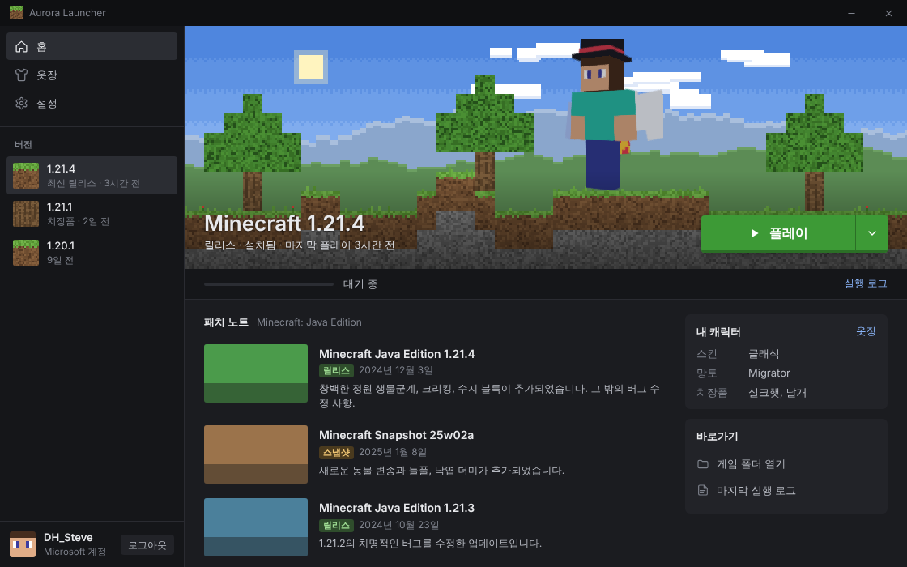

# Aurora Launcher

Windows용 비공식 Minecraft: Java Edition 런처입니다.



- Microsoft 정품 계정 로그인
- 버전 선택과 실행 (게임 파일은 Mojang 공식 서버에서 받습니다)
- 옷장: 계정 망토 변경, 스킨 업로드
- 치장품 모드 (1.21.1, Fabric): 실크햇, 왕관, 후광, 날개. 내 화면에서만 보입니다.
- 자동 업데이트 (GitHub Releases)

## 설치

[Releases](../../releases/latest)에서 `Aurora-Launcher-Setup-x.y.z.exe`를 받아 실행하세요.

## 개발

```bash
npm install
npm start          # 개발 모드 실행
npm run dist       # Windows 설치 파일 빌드
```

치장품 모드는 `cosmetics-mod/` 에 있습니다 (`gradle build`). 빌드된 jar 는 `src/assets/aurora-cosmetics.jar` 로 복사해 런처에 넣습니다.

## 고지

Aurora Launcher 는 비공식 런처이며 Mojang Studios 또는 Microsoft 와 관련이 없습니다.
Minecraft 는 Mojang Synergies AB 의 상표입니다. 플레이하려면 정품 계정이 필요합니다.
