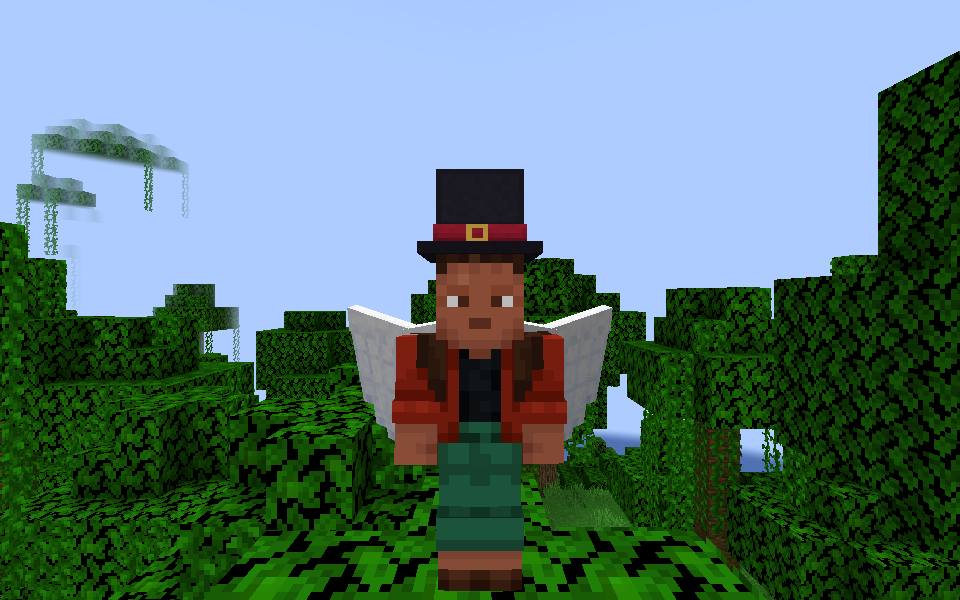
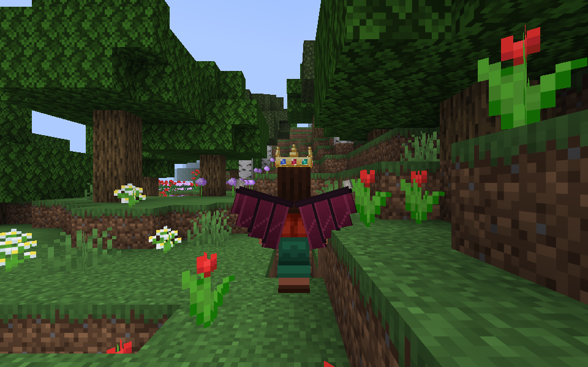
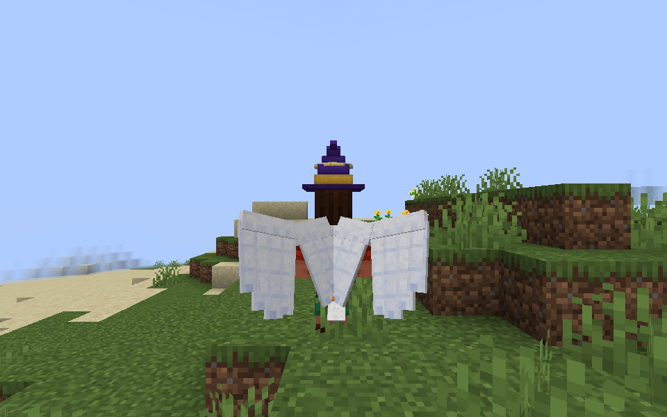

# Aurora Launcher

Windows용 비공식 Minecraft: Java Edition 런처입니다.


- Microsoft 정품 계정 로그인
- 버전 선택과 실행 (게임 파일은 Mojang 공식 서버에서 받습니다)
- 옷장: 계정 망토 변경, 스킨 업로드
- 치장품 8종 (1.20 ~ 26.x, Fabric): 실크햇, 왕관, 마법사 모자, 고양이 귀, 후광, 천사 날개, 악마 날개, 여우 꼬리. 내 화면에서만 보입니다.
- 자동 업데이트 (GitHub Releases)

## 설치

[Releases](../../releases/latest)에서 `Aurora-Launcher-Setup-x.y.z.exe`를 받아 실행하세요.

## 개발

```bash
npm install
npm start          # 개발 모드 실행
npm run dist       # Windows 설치 파일 빌드
```

### 치장품

| 1.21.4 | 1.21.11 | 1.20.1 |
| --- | --- | --- |
|  |  |  |

치장품(모양, 텍스처, 애니메이션)은 `cosmetics-mod/tools/gen_cosmetics.py` 한 곳에서 정의합니다.
이 스크립트가 게임 모드용 `cosmetics.json` + 텍스처와 런처 미리보기용 `src/renderer/cosmetics/cosmetics.data.js` 를 함께 만듭니다.

```bash
cd cosmetics-mod
python3 tools/gen_cosmetics.py common/src/main/resources ../src/renderer/cosmetics
node tools/thumbs.js   # 옷장 카드 썸네일
```

게임 모드는 Minecraft 버전 묶음마다 따로 빌드합니다. 공통 코드는 `cosmetics-mod/common`, 버전별 연결 코드는 `cosmetics-mod/versions/*` 에 있습니다.

| 폴더 | 지원 버전 | 빌드 |
| --- | --- | --- |
| `v1_20` | 1.20 – 1.20.4 | Gradle 8, Java 21 |
| `v1_20_5` | 1.20.5 – 1.20.6 | Gradle 8, Java 21 |
| `v1_21` | 1.21 – 1.21.1 | Gradle 8, Java 21 |
| `v1_21_2` | 1.21.2 – 1.21.4 | Gradle 8, Java 21 |
| `v1_21_5` | 1.21.5 – 1.21.8 | Gradle 8, Java 21 |
| `v1_21_9` | 1.21.9 – 1.21.10 | Gradle 8, Java 21 |
| `v1_21_11` | 1.21.11 | Gradle 8, Java 21 |
| `v26` | 26.1 이상 (스냅샷 포함) | `./gradlew`, Java 25 |

빌드한 jar 는 `src/assets/cosmetics-mods/<폴더>.jar` 로 복사하고, 범위는 `src/assets/cosmetics-mods/index.json` 에 적습니다.
런처는 고른 게임 버전에 맞는 jar 를 Fabric 과 함께 자동으로 넣습니다. 1.20 보다 오래된 버전은 지원하지 않습니다.

## 고지

Aurora Launcher 는 비공식 런처이며 Mojang Studios 또는 Microsoft 와 관련이 없습니다.
Minecraft 는 Mojang Synergies AB 의 상표입니다. 플레이하려면 정품 계정이 필요합니다.
